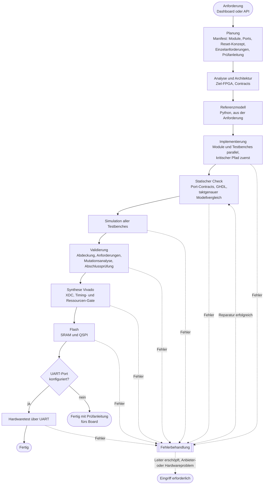

# VHDL-Agent – autonomes Multiagentensystem für den FPGA-Entwurf


*LLM-basierte autonome Agentenplattform zur Software- und Systemartefakterzeugung, hier umgesetzt für den Schaltungsentwurf: von einer Anforderung in natürlicher Sprache bis zum geflashten und getesteten FPGA.*

Stand: 2026-10-13 · Lizenz: MIT · Das Projekt entsteht im Rahmen einer Abschlussarbeit.

**Inhalt:** [Überblick](#überblick) · [Ergebnisse](#ergebnisse) · [Voraussetzungen und Schnellstart](#voraussetzungen-und-schnellstart) · [Wie das System arbeitet](#wie-das-system-arbeitet) · [OpenCode und Modelle](#opencode-ausführung-und-modelle) · [Konfiguration](#konfiguration) · [Hardwaretests](#hardwaretests-über-uart) · [Dashboard](#dashboard) · [Benchmarks](#benchmarks) · [Trainingsdaten](#lauf-trajektorien-als-trainingsdaten) · [Projektstruktur](#projektstruktur) · [Tests](#tests) · [Dokumentation](#dokumentation) · [Grenzen](#bekannte-grenzen) · [Forschungskontext](#forschungskontext-und-architekturvergleich)

---

## Überblick

Der Benutzer beschreibt eine Schaltung („8-Bit-CPU mit Rechenwerk, Steuerwerk und Speicher, Ausgabe über die LEDs“). Ein **Supervisor** zerlegt die Aufgabe und führt spezialisierte Agenten durch feste Phasen. Jede Phase hat ein **Gate**, das bestanden sein muss; Fehler werden vorgefiltert und gezielt an die zuständige Rolle zurückgegeben, statt den Lauf abzubrechen. Am Ende steht ein auf das **Arty S7-50** (Spartan-7) geflashter Entwurf – bei angeschlossener UART mit automatischem Hardwaretest.

Alle Sprachmodell-Aufgaben laufen über [OpenCode](https://opencode.ai): Planung, VHDL-Module, Testbenches, Referenzmodelle, Reparaturen und Chat-Antworten. Alles andere ist deterministisch: GHDL für Analyse und Simulation, Vivado für Synthese und Flash, eigener Code für Verträge, Prüfungen und Eskalation.

Leitfrage: **Erzeugt ein Multiagentensystem (MAS) bei gleichem Sprachmodell bessere Entwürfe als ein einzelner OpenCode-Lauf – und was kostet das?** Dafür gibt es ein Benchmark-Werkzeug mit unabhängigen Referenz-Testbenches ([Benchmarks](#benchmarks)).

Grundsätze des Systems:

- **Autonom:** Es gibt keine Freigabeschritte. Der Benutzer wird nur gerufen, wenn die Eskalationsleiter erschöpft ist oder Werkzeug, Board oder Anbieter ausfallen.
- **Nachprüfbar:** Jede Einzelanforderung wird bis zur Abschlussprüfung verfolgt; ein ausführbares Referenzmodell und eine Mutationsanalyse prüfen die Prüfungen selbst.
- **Nachvollziehbar:** Projektzustand, Ereignisse, Diagnosen und Reparaturen werden gespeichert, jede übernommene Idee ist in [`docs/doku.html`](docs/doku.html) mit Quelle belegt.

---

## Ergebnisse

Zwei CPU-Entwurfsaufgaben wurden mit dem MAS und mit **einem einzelnen OpenCode-Aufruf** (gleiches Modell: `opencode/muse-spark-1.3-contributor-free`) gelöst und auf dem Arty S7-50 geprüft:

| | Aufgabe 04: 4-Bit-Akkumulator-CPU | Aufgabe 05: Ben-Eater-8-Bit-Rechner |
|---|---|---|
| Umfang | 10 Module, Rechenwerk, Steuerwerk, Speicher, Fibonacci-Demo an den LEDs | 12 Module, Original-Mikrocode mit 16 Steuersignalen, UART-Lader |
| MAS (Läufe) | 3 Läufe: 37,7 / 38,0 / 47,1 min, 0 / 0 / 2 Reparaturen | 1 Lauf: 45:44 min, 0 Reparaturen, 27 OpenCode-Aufrufe |
| Single (Lauf) | 4,6 min bis zum simulierten Entwurf, ca. 10,5 min bis zum Board | 8,4 min bis zum simulierten Entwurf, ca. 14,5 min bis zum Hardwaretest |
| Referenz-Testbench | alle Entwürfe bestanden | beide Entwürfe bestanden |
| Am Board | LED-Ausgabe vom Benutzer bestätigt | Hardwaretest über UART 4/4, im MAS-Lauf **automatisch** |

Einordnung (ehrlich, bei je 1–3 Läufen eine Stichprobe):

- **Korrektheit:** Bei diesen genau spezifizierten Aufgaben löst ein einzelner Aufruf dasselbe Problem ebenso richtig und **deutlich schneller**. Das MAS gewinnt nicht bei der Lösungsquote.
- **Nachweisbarkeit:** Das MAS liefert eine Testbench je Modul, eine begründete Bewertung jeder Einzelanforderung (74–91 bzw. 78), Mutationsquoten bis 1,0 und den durchgehenden Weg bis zum bestandenen Hardwaretest. In einem Lauf fand der taktgenaue Vergleich mit dem Referenzmodell einen Entwurfsfehler von einem Takt, den weder die Testbenches noch die Referenz-Testbench sahen.
- **Offen:** Ob das MAS bei unschärfer spezifizierten oder größeren Aufgaben mehr leistet.

Frühe Messungen (Oktober 2026) lagen noch hinter einem einzelnen OpenCode; die Ursachenanalyse und die daraus folgenden Maßnahmen (#1–#60) stehen in [`docs/doku.html`](docs/doku.html), Abschnitt 15. Ausführlich dokumentiert sind die beiden Aufgaben in [`docs/Aufgabe04_Mini-CPU.pdf`](docs/Aufgabe04_Mini-CPU.pdf) und [`docs/Aufgabe05_Ben-Eater-8Bit.pdf`](docs/Aufgabe05_Ben-Eater-8Bit.pdf); alle Rohdaten liegen unter [`docs/benchmark/ergebnisse/`](docs/benchmark/ergebnisse/).

---

## Voraussetzungen und Schnellstart

| Komponente | Zweck | Getestet mit |
|---|---|---|
| Python ≥ 3.11 | Server und Agenten | 3.12 |
| [OpenCode](https://opencode.ai) CLI im `PATH` | alle Sprachmodell-Aufgaben | 1.18.35 |
| GHDL | Analyse, Simulation, Mutationsanalyse | 4.1.0 |
| git | eigenes Repository je Workspace | – |
| Vivado (die kostenlose Lizenz genügte) | Synthese, Bitstream, Flash | 2026.1 |
| openFPGALoader | alternativer Flash-Weg | 0.12.0 |
| `pyserial` (im venv) und USB-UART des Boards | automatischer Hardwaretest | – |
| Docker | nur für den Isolationsmodus ([siehe unten](#opencode-ausführung-und-modelle)) | – |

Alle realen Läufe liefen auf dem **Digilent Arty S7-50** (Board-Wissen, XDC-Erzeugung und Flash sind dafür geprüft). Die FPGA-Registry (`Schaltungsagent/src/data/fpgas.yaml`) kennt zusätzlich das GateMate A1.

```bash
# 1. Starten: prüft die Komponenten und bietet bei fehlenden den Installer an
python3 start.py --test-mode            # oder: VHDL_AGENT_TEST_MODE=1 python3 start.py

# 2. Dashboard öffnen
#    http://localhost:8088
```

Vorher in `config.yaml` die Pfade zu Vivado anpassen (`vivado.binary`, `vivado.settings_script`) und für den Hardwaretest `hardware_test.uart_port` setzen (z. B. `/dev/ttyUSB1`). Die Einrichtung von Vivado und Board beschreibt [`docs/FPGA/vivado-setup.md`](docs/FPGA/vivado-setup.md).

Eine Aufgabe lässt sich im Dashboard eintippen oder wie das Dashboard per API schicken:

```bash
curl -X POST http://localhost:8088/api/chat -H 'Content-Type: application/json' \
  -d '{"user_request": "Erstelle in VHDL-2008 einen 8-Bit-Zähler mit synchronem Reset für das Arty S7-50. Ausgabe auf den LEDs.", "domain": "vhdl"}'
# Fortschritt: WebSocket ws://localhost:8088/ws
```

Beispiele für vollständige Aufgaben stehen in `Schaltungsagent/benchmark/prompts/` (Aufgabe 05 ist die ausführlichste). Erzeugte Projekte liegen unter `projects/<name>/` (nicht im Repository).

---

## Wie das System arbeitet



Der vollständige Ablauf einschließlich Fehlerbehandlung steht in [`docs/architecture/MAS-Ablauf.md`](docs/architecture/MAS-Ablauf.md) (Mermaid) und als draw.io-Datei mit Piktogrammen ([`MAS-Ablauf.drawio`](docs/architecture/MAS-Ablauf.drawio)); Klassen und Zuständigkeiten in [`MAS-UML.md`](docs/architecture/MAS-UML.md).

### Rollen

| Rolle | Aufgabe |
|---|---|
| **SupervisorAgent** | führt die Phasen, prüft die Gates, steuert Fehlerbehandlung und Eskalation, schreibt den Projektzustand (`design_state.yaml`) |
| **PlanService / ArchitectureAgent** | Plan (`plan/manifest.json`) aus der Anforderung: Module, Ports als verbindliche Contracts, Reset-Konzept, Einzelanforderungen mit wörtlichem Zitat; Prüfung mit Korrekturschleife |
| **HDLAgent** | je Modul ein OpenCode-Auftrag für VHDL und Testbench, HDL-Reparaturen |
| **VerificationAgent** | Referenzmodell, Überarbeitung von Testbenches, unabhängige Abschlussprüfung der Anforderungen |
| **DebugAgent** | Vorfilter (Triage) aller Fehler |
| **FPGAAgent** | GHDL-/Vivado-Synthese, XDC, Timing- und Ressourcen-Gate, Flash |
| **HardwareTestAgent** | Hardwaretests über die UART |

Der Originalprompt liegt unverändert als `PROMPT.md` im Workspace; vor jedem OpenCode-Auftrag wird seine Prüfsumme kontrolliert. Wissen für die Agenten (Board-Fakten, Regeln für Synthese, FSM, Testbenches, Fehlermeldungen) wird als versionierte `AGENTS.md` samt Skills in jeden Workspace kopiert (`Schaltungsagent/src/knowledge/`).

### Gates

| Phase | Gate |
|---|---|
| Planung | Manifest gültig (Entities, Contracts, Abhängigkeiten ohne Zyklus, Einzelanforderungen mit Zitat); bis zu drei Versuche, jeder mit den konkreten Verstößen als Korrekturauftrag |
| Analyse | Ziel-FPGA bestimmt; widersprüchliche Angaben führen zur Rückfrage |
| Referenzmodell | Python-Modell mit Selbsttest, geschrieben vor der Implementierung |
| Implementierung | persistierter TaskGraph; eine Aufgabe startet, sobald ihre Abhängigkeiten fertig sind (längster Pfad zuerst); Checkpoint nach jeder Aufgabe; Testbench je Modul mit eigener Logik |
| Statischer Check | Port-Contracts (Existenz, Richtung, Typ, Bitbreite, Top-Level), GHDL-Analyse, **taktgenauer Vergleich mit dem Referenzmodell** (Zufallsfolgen) |
| Simulation | alle Testbenches laufen bis `TB_COMPLETE` ohne fehlgeschlagene Assertion |
| Validierung | jedes Modul von einer Testbench erreicht; jede Einzelanforderung in einer Testbench belegt; Mutationsquote ≥ 0,6 (einmal Nachbesserung der Testbenches, danach nur Warnung); unabhängige Abschlussprüfung aller Anforderungen |
| Synthese | Vivado-Reports vorhanden, Clock-Constraint gesetzt, WNS/WHS ≥ 0, Auslastung ≤ 100 %; Cache bei unverändertem Entwurf |
| Flash | ohne Benutzerfreigabe; SRAM und QSPI-Flash; Board-Konfiguration (z. B. `SPI_BUSWIDTH 4`) setzt das Build-Skript immer |
| Hardwaretest | mit UART-Port: Tests aus dem Plan; ohne Port wird kein Erfolg gemeldet, stattdessen enthält die Abschlussmeldung eine von der Abschlussprüfung gegengeprüfte Prüfanleitung fürs Board |

### Fehlerbehandlung: vorfiltern, zuordnen, eskalieren

1. **Vorfilter** (`src/domain/agents/triage.py`): holt die Kernzeilen aus der GHDL-/Vivado-Ausgabe, bestimmt die Fehlerklasse und die **Herkunft** (Entwurf, Testbench, Anforderungen, Werkzeug/Konfiguration, Hardware, Infrastruktur) und ordnet Module nur über belegbare Dateiverweise zu.
2. **Routing** (`repair_routing.py`): Interface- und Planfehler an den ArchitectureAgent, Modul- und Contractfehler an den HDLAgent, Test- und Abdeckungslücken an den VerificationAgent, Synthese-, Timing- und Constraint-Fehler an die FPGA-Reparatur, fehlende Werkzeuge und Board-/Kabelprobleme an den Benutzer.
3. **Eskalationsleiter** je Herkunft (Versuche je Fehlerklasse und Modul):

| Herkunft | Versuch 1–2 | 3–4 | 5 | 6–7 | danach |
|---|---|---|---|---|---|
| Entwurf | gezielte Reparatur | Modul neu schreiben | Architektur überarbeiten | Fallback-Modell | Mensch |
| Testbench, Abdeckung | gezielte Reparatur | Fallback-Modell | – | – | Mensch |
| Anforderungen fehlen im Plan | Plan ergänzen | Fallback-Modell | – | – | Mensch |
| Werkzeug, Konfiguration | Neubau bzw. Reparatur mit Vivado-Kontext | Fallback-Modell | – | – | Mensch |
| Hardware, Infrastruktur, Anbieterausfall | sofort Mensch | | | | |

4. **Befund und Modellstreit:** Jede Reparatur schreibt eine strukturierte Ursache (`reports/repair_verdict.json`). Hält sie das Referenzmodell für falsch, wird es einmal mit dem Befund neu erzeugt; nur wenn der Streit bleibt, wird der Vergleich abgeschaltet. Verschlechtert eine Reparatur eine frühere Phase, wird sie zurückgenommen.

`opencode.repair_policy: persistent` (Standard, echte Läufe) eskaliert so lange, bis die Leiter erschöpft ist; `standard` (Benchmarks) erlaubt einen Versuch je Fehler.

---

## OpenCode-Ausführung und Modelle

**Aktueller Stand: nativ.** Alle Entwicklungs- und Messläufe führen OpenCode direkt auf dem Host aus (`opencode.test_mode: true`, bzw. `--test-mode`). Dafür ist jeder Workspace ein **eigenes Git-Repository** mit einer `opencode.json`, die `external_directory: deny` setzt, damit OpenCode nicht im Repository des Systems arbeitet; eine `.gitignore` hält Build-Artefakte aus OpenCodes Suche heraus. Das ist **keine echte Isolation** – OpenCode läuft mit den Rechten des Benutzers.

**Docker-Isolation ist implementiert, aber zurückgestellt**, bis das MAS einen einzelnen OpenCode-Lauf messbar schlägt (siehe [`docs/benchmark/METHODIK.md`](docs/benchmark/METHODIK.md)). Ohne Testmodus startet OpenCode in Docker, und es gibt **keinen** stillen Rückfall auf den Host. Einstellbar im Dashboard unter *Einstellungen → Agenten-Ausführung*:

| Einstellung | Bedeutung |
|---|---|
| Isolation `per_task` (Standard) | jeder Auftrag startet einen eigenen Container (`docker run --rm`), eingebunden ist nur das Projektverzeichnis; ohne Capabilities, ohne Rechteausweitung, als Host-Benutzer |
| Isolation `shared` | `docker exec` in einen laufenden Container (`docker compose up -d opencode`), der nur `./projects` sieht |
| Image, Netzwerk, Speicher-/CPU-Limit | Container-Parameter für `per_task` |
| Zugangsdaten | Host-Verzeichnis der OpenCode-Zugangsdaten, wird schreibgeschützt eingebunden |

### Modell und Fallback-Modell

`opencode.model` und `opencode.fallback_model` sind Freitext: Der String geht unverändert als `--model <wert>` an OpenCode. Eine Verwechslung fällt deshalb erst beim nächsten Lauf auf, oft mit einer irreführenden Providermeldung. Kostenlose OpenCode-Zen-Modelle tragen das Suffix `-free` (z. B. `opencode/muse-spark-1.3-contributor-free`); ohne den Zusatz greift ein kostenpflichtiges Modell, das ohne Guthaben fehlschlägt.

Im Dashboard lädt *Einstellungen → OpenCode-Modelle → „Modelle laden“* die tatsächlich verfügbaren Modelle (`opencode models`, nach Provider gruppiert) in ein Dropdown; das Laden kann bei kaltem Cache 10–20 s dauern.

- Meldet OpenCode das Kontingent des Providers, wird der Aufruf einmal mit dem Fallback-Modell wiederholt; die Eskalationsleiter nutzt es ebenfalls.
- Fällt der **Anbieter** aus (z. B. `Upstream request failed`), gilt das als Infrastrukturfehler: Es folgen keine sinnlosen Reparaturen, die Implementierung startet keine weiteren Aufgaben, und der Lauf endet mit einer Meldung. Er wartet nicht von selbst, bis der Anbieter zurück ist.
- Ein Zeitlimit je Aufruf (`opencode.default_timeout`, 900 s) ist kein Ausfall; die Eskalation geht dann zur nächsten Stufe.

---

## Konfiguration

Alle Einstellungen stehen in `config.yaml` und lassen sich im Dashboard unter *Einstellungen* ändern (Änderungen an `opencode` wirken sofort, die übrigen nach dem Neustart).

```yaml
opencode:
  model: opencode/muse-spark-1.3-contributor-free
  fallback_model: opencode/mimo-v2.6-flash-free
  default_timeout: 900            # Sekunden je OpenCode-Aufruf
  test_mode: true                 # nativ statt Docker
  repair_policy: persistent       # Eskalation statt Abbruch (Benchmarks: standard)
  implementation_mode: modular    # ein Auftrag je Modul; oder single_session
limits:
  max_parallel_workers: 2         # 1 = sequentiell
gates:
  min_module_coverage: 1.0        # Anteil der Module, die simuliert werden müssen
  enforce_contracts: true
  min_mutation_score: 0.6
  requirements_review: true       # unabhängige Abschlussprüfung der Anforderungen
  require_timing_closure: true
synthesis:
  enabled: true                   # false: Lauf endet nach der Validierung
  default_fpga: arty_s7_50
vivado:
  binary: /pfad/Xilinx/2026.1/Vivado/bin/vivado
  settings_script: /pfad/Xilinx/2026.1/Vivado/settings64.sh
hardware_test:
  uart_port: /dev/ttyUSB1         # leer = kein Hardwaretest, kein Hardware-Erfolg
  baudrate: 115200
  uart_integration: auto          # auto | always | off (siehe unten)
workspace:
  runs_dir: ~/vhdl-agent-runs     # Lauf-Trajektorien; leer = aus
  cleanup_after_success: true     # GHDL-/Vivado-Zwischenstände nach erfolgreichem Lauf löschen
```

---

## Hardwaretests über UART

Mit gesetztem `hardware_test.uart_port` lädt der HardwareTestAgent nach dem Flash Testprogramme über die USB-UART des Boards (115 200 Baud) in den Entwurf und vergleicht die Antwort. Ohne Port werden Hardwaretests übersprungen und **nie** als bestanden gemeldet.

Projektspezifische Tests kommen aus dem Plan-Manifest (`hardware_tests`) oder aus `tests/hardware_tests.yaml`:

```yaml
tests:
  - name: multiply_7x9
    type: cpu_program          # oder uart_exchange / echo
    program: "1E3C761DE0F04E1D2F4D600001000709"
    expected: "3f"
    requirement: "Multiplikation durch Addition"
```

Protokoll von `cpu_program`: 4 Byte Länge (little endian), die Programmbytes, dann `START` und Zeilenvorschub; danach liest der Test so viele Antwortbytes, wie `expected` lang ist. Die Aufgabe muss den Lader im Entwurf selbst verlangen (Beispiel: Aufgabe 05).

`uart_integration`: Hat ein Entwurf **keine** eigene UART, baut das System bei echtem Hardwaretest eine **UART-Echo-Brücke** in das Top-Level ein (`auto`, `always`) oder nie (`off`). Hat das geplante Top-Level selbst UART-Ports (`uart_rx`/`uart_tx`), unterbleibt die Brücke. Pins nach der offiziellen Digilent-Master-XDC: Eingang `uart_rx` = V12, Ausgang `uart_tx` = R12.

---

## Dashboard

Das Dashboard (`Schaltungsagent/src/dashboard/`, HTML/CSS/JavaScript ohne Build-Schritt) wird vom FastAPI-Server ausgeliefert und zeigt:

- **Chat** mit dem System (neue Aufgaben, Änderungswünsche an bestehenden Projekten, Fragen zum Projekt),
- **Workflow & Prüfungen** mit Phasen, Gates und Ereignisprotokoll (Worker, OpenCode-Aufrufe mit Dauer, Eskalationen, Befunde der Agenten),
- **Projekte** mit Dateien, Code, Gedächtnis (`memory.md`) und dem Öffnen in EDA-Werkzeugen,
- **Einstellungen**: Agenten-Ausführung, OpenCode-Modelle, Gates, Limits, Vivado, Hardwaretest, Darstellung.

---

## Benchmarks

Werkzeug: `Schaltungsagent/benchmark/mas_vs_single.py`; Aufgaben in `Schaltungsagent/benchmark/prompts/`, unabhängige Referenz-Testbenches (dem System unbekannt) in `Schaltungsagent/benchmark/reference/`.

| Aufgabe | Inhalt |
|---|---|
| 01 Zähler | ein Modul |
| 02 Hamming-Decoder | ein Modul, Fehlerkorrektur |
| 03 Ampel | hierarchisch, drei Module, Generics |
| 04 Mini-CPU | 4-Bit-Akkumulator-CPU, 10 Module, Fibonacci-Demo an den LEDs |
| 05 Ben-Eater-8-Bit | originalgetreuer Nachbau mit Mikrocode und UART-Lader, 12 Module, automatischer Hardwaretest |

Varianten: `single` (ein OpenCode-Aufruf), `mas` (modular), `mas-single` (MAS mit einer Sitzung für das ganze Projekt). Alle werden mit demselben GHDL-Validator und derselben Referenz-Testbench bewertet.

```bash
cd Schaltungsagent
../.venv/bin/python benchmark/mas_vs_single.py --prompt-files 04_mini_cpu.md --variants single mas --repeat 3
# einzelner Aufruf mit längerem Zeitlimit für große Aufgaben:
../.venv/bin/python benchmark/mas_vs_single.py --prompt-files 05_ben_eater_8bit.md --variants single --opencode-timeout 3600
```

Methodik, Metadaten je Lauf (`meta.json`) und alle Ergebnisse stehen in [`docs/benchmark/`](docs/benchmark/); die Arbeitsverzeichnisse der Läufe liegen unter `~/vhdl-agent-benchmark/`. Zusätzlich wurden Messungen mit dem externen *small_vhdl_bench* durchgeführt (`Schaltungsagent/benchmark/small_vhdl_bench-main`).

---

## Lauf-Trajektorien als Trainingsdaten

Jeder Lauf schreibt eine Trajektorie nach `~/vhdl-agent-runs/<projekt>/<zeit>.jsonl` – bewusst **außerhalb** des Workspaces, damit sie OpenCodes Kontext nicht aufbläht: Anforderung, Plan (mit Planungsversuchen), Phasenergebnisse, vorgefilterte Diagnosen (Kernzeilen, Fehlerklasse, Herkunft), jede Reparatur mit Maßnahme, Befund und Diff sowie der Endstand der Quellen. Pfade, Home-Verzeichnis und Rechnername werden ersetzt; das Feld `origin` erlaubt, Werkzeug- und Hardwarefehler herauszufiltern. Gedacht ist das als Material für spezialisierte Modelle zur Fehlerreparatur.

---

## Projektstruktur

```
vhdl-agent/
├── start.py                     Einstieg: prüft Voraussetzungen, startet Server und Dashboard
├── config.yaml                  Konfiguration (auch im Dashboard änderbar)
├── installer/                   Installer für Systempakete, venv und OpenCode-Image
├── Schaltungsagent/
│   ├── src/
│   │   ├── agents/              Supervisor, Architektur-, HDL-, Verifikations-, Debug-, FPGA-, Hardwaretest-Agent
│   │   ├── domain/              Zustandsautomat, Modelle, Ports; agents/: Triage, Reparaturrouting,
│   │   │                        Referenzmodell, Mutationsanalyse, Anforderungen, TaskGraph, Contracts
│   │   ├── services/            OpenCode-Anbindung, Planung, Workspace, Wissen, Trajektorien, Aufräumen
│   │   ├── infrastructure/      GHDL-Validator, Vivado-Synthese und -Flash
│   │   ├── orchestrator/        SupervisorOrchestrator, Agentenfabrik
│   │   ├── domain_plugins/vhdl/ VHDL-Vorlagen, Prompts, Testdefinitionen
│   │   ├── knowledge/           Board-Fakten und Skills für die Agenten
│   │   ├── data/fpgas.yaml      FPGA-Registry
│   │   └── dashboard/           Weboberfläche
│   ├── tests/, src/tests/       Testsuite
│   └── benchmark/               Aufgaben, Referenz-Testbenches, Vergleichswerkzeug
├── docs/                        Dokumentation (siehe unten)
└── projects/                    erzeugte Projekte (nicht im Repository)
```

---

## Tests

```bash
cd Schaltungsagent
../.venv/bin/python -m pytest -q        # rund 600 Tests; GHDL-Tests werden ohne GHDL übersprungen
```

---

## Dokumentation

| Datei | Inhalt |
|---|---|
| [`docs/doku.html`](docs/doku.html) | Softwaredokumentation; Abschnitt 15: Analyse und alle Verbesserungen #1–#60 mit Anlass, Maßnahme und Status; Abschnitt 16: Referenzmodell und Mutationsanalyse; Abschnitt 17: **Herkunft der Ideen** mit Literatur |
| [`docs/known_limitations.md`](docs/known_limitations.md) | bekannte Grenzen, Grundlage für die Diskussion in der Arbeit |
| [`docs/architecture/`](docs/architecture/) | Ablauf ([`MAS-Ablauf.md`](docs/architecture/MAS-Ablauf.md), [`.drawio`](docs/architecture/MAS-Ablauf.drawio)), UML ([`MAS-UML.md`](docs/architecture/MAS-UML.md)), Entwicklungsverlauf ([`AENDERUNGSPROTOKOLL.md`](docs/architecture/AENDERUNGSPROTOKOLL.md), [`.drawio`](docs/architecture/AENDERUNGSPROTOKOLL.drawio)), frühere Konzepte in `lagacy/` |
| [`docs/benchmark/`](docs/benchmark/) | Methodik und Ergebnisse aller Messläufe |
| [`docs/Aufgabe04_Mini-CPU.pdf`](docs/Aufgabe04_Mini-CPU.pdf), [`docs/Aufgabe05_Ben-Eater-8Bit.pdf`](docs/Aufgabe05_Ben-Eater-8Bit.pdf) | ausführliche Dokumentation der Entwurfsaufgaben 04 und 05 mit Ergebnissen |
| [`docs/FPGA/vivado-setup.md`](docs/FPGA/vivado-setup.md) | Einrichtung von Vivado und Arty S7-50 |
| [`docs/paper/`](docs/paper/) | Fachartikel zum Referenzmodell-Ansatz (FPGAgent, arXiv:2608.23630) |

---

## Bekannte Grenzen

Vollständig in [`docs/known_limitations.md`](docs/known_limitations.md). Die wichtigsten:

- **Keine GPIO-Beobachtung:** Ohne UART-Schnittstelle prüft das System die Board-Funktion nicht selbst; die Abschlussmeldung enthält dann eine Prüfanleitung (Schalterstellung → erwartete LED-Folge), die ein Mensch abarbeitet.
- **Prüfungen mit begrenzter Aussagekraft:** Das Referenzmodell ist eine zweite Auslegung derselben Spezifikation durch ein Sprachmodell; Abschlussprüfung und Prüfanleitung sind Sprachmodell-Urteile. Mehrdeutige Aufgaben führen zu Streit zwischen Entwurf und Modell – das System löst ihn einmal durch Neuerzeugung, entscheiden kann es ihn nicht.
- **Contracts ohne Protokollsemantik:** Geprüft werden Ports, Richtung, Typ und Bitbreite, nicht Latenz, Handshake oder Clock-Domain-Übergänge.
- **Isolation nur nativ**, kein automatisches Fortsetzen nach einem Neustart (Zustand und TaskGraph erlauben es), parallele Worker teilen einen Workspace.
- **Freie Modelle** haben Rate-Limits und fallen zeitweise aus; Ergebnisse streuen zwischen Läufen und sind modellabhängig.
- **Ein Board:** Alle realen Läufe liefen auf dem Arty S7-50.

---

## Forschungskontext und Architekturvergleich

Moderne Sprachmodelle ermöglichen autonome Agentensysteme, die Aufgaben planen, Werkzeuge verwenden und Ergebnisse prüfen. Für komplexe technische Artefakte entstehen besondere Anforderungen: Zerlegung in Teilaufgaben, Koordination von Spezialagenten, Verwaltung von Zwischenzuständen, Fehlererkennung und Wiederherstellung, Nachvollziehbarkeit sowie sichere Ausführung eines nicht deterministischen Systems. Das Projekt untersucht dafür verschiedene Agentenarchitekturen und entwickelt eine Umgebung für den praktischen Einsatz.

| Anforderung | Umsetzung |
|---|---|
| Modularität | Rollen als austauschbare Agenten; Domänen-Plugin (`domain_plugins/vhdl`) für Vorlagen, Prompts und Prüfungen |
| Sicherheit | nativ: Verzeichnissperre und eigenes Repository je Workspace; Docker-Isolation implementiert, zurückgestellt |
| Fehlertoleranz | Vorfilter, Eskalationsleiter, Rücknahme verschlechternder Reparaturen, Checkpoints von Projektzustand und TaskGraph |
| Nachvollziehbarkeit | `design_state.yaml`, Ereignisse, strukturierte Befunde, Lauf-Trajektorien, Prüfsummen, Quellenangabe je Idee in `doku.html` |
| Skalierbarkeit | parallele Worker auf dem Abhängigkeitsgraphen, kritischer Pfad zuerst |
| Flexibilität | Sprachmodell frei wählbar über OpenCode; andere Agentenframeworks wurden verworfen |

Verglichen werden:

- **Hierarchische Subagenten (Orchestrator-Worker):** Ein Supervisor plant und delegiert an spezialisierte Agenten. Das ist die umgesetzte Architektur.
- **Einzelner Agent:** Ein OpenCode-Aufruf löst die ganze Aufgabe. Das ist die Vergleichsbasis der Benchmarks.
- **Blackboard-Orchestrator mit austauschbaren Agenten** (Hermes, LangChain, CrewAI, OpenCode): das frühe Konzept, nicht weiterverfolgt.

<details>
<summary>Frühes Konzept (Juli/August 2026, überholt)</summary>


Der Weg von diesem Konzept zum heutigen System, Schritt für Schritt: [`docs/architecture/AENDERUNGSPROTOKOLL.drawio`](docs/architecture/AENDERUNGSPROTOKOLL.drawio).

</details>

---

## Lizenz

MIT – siehe [`LICENSE`](LICENSE).
