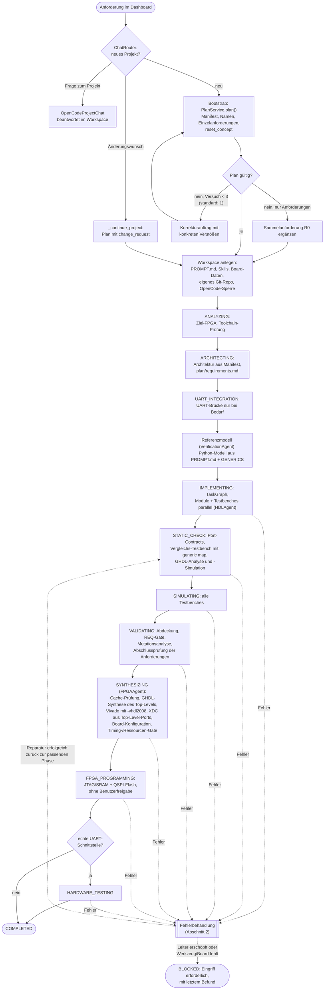
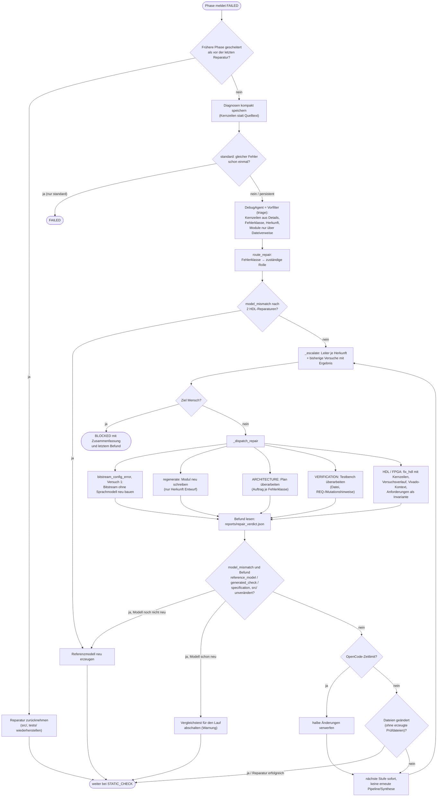
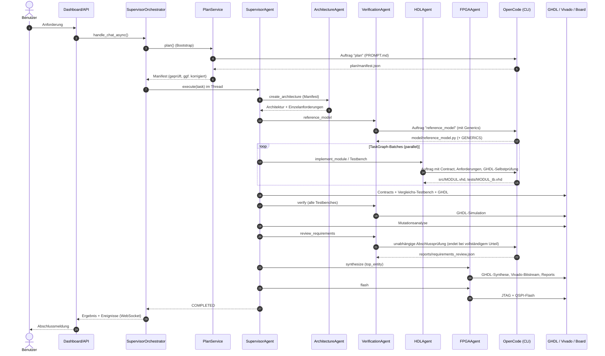

# Ablauf des VHDL-Multiagentensystems

Stand: 2026-10-12 (Branch `mas-verbesserungen-2026-10-11`, Commit `63a4752`). Klassen und
Zuständigkeiten: [MAS-UML.md](MAS-UML.md). Beschrieben ist der Modus
`opencode.repair_policy: persistent` (echte Läufe); Unterschiede zu `standard` (Benchmark) sind
markiert.

## 1. Gesamtablauf eines Laufs

## 2. Fehlerbehandlung: Vorfilter, Weitergabe, Eskalation

Eskalationsleitern (Versuch je Fehlerklasse und Modul → Maßnahme):

| Herkunft (Vorfilter) | Versuch 1–2 | 3–4 | 5 | 6–7 | danach |
|---|---|---|---|---|---|
| Entwurf (Syntax, Simulation, Modell, Synthese, Timing, Anforderung verletzt) | gezielte Reparatur | Modul neu schreiben | Architektur überarbeiten | Fallback-Modell, Reparatur | Mensch |
| Testbench / Abdeckung / REQ-Lücke | gezielte Reparatur | Fallback-Modell, Reparatur | – | – | Mensch |
| Anforderungen fehlen im Plan | Plan ergänzen | Fallback-Modell, Plan ergänzen | – | – | Mensch |
| Werkzeug / Konfiguration (Constraints, Bitstream-Konfiguration) | Neubau bzw. Reparatur mit Vivado-Kontext | Fallback-Modell | – | – | Mensch |
| Hardware / Infrastruktur (Board, Kabel, fehlendes Werkzeug, Anbieter) | sofort Mensch | | | | |

Im Modus `standard` gibt es keine Leiter: ein Reparaturversuch je Fehler, Abbruch bei
wiederholtem gleichem Fehler, ein Planungsversuch.

## 3. Zusammenspiel der Agenten (Sequenz eines erfolgreichen Laufs)

Alle Agenten veröffentlichen Ereignisse über den `EventBus`; der API-Server leitet sie per
WebSocket an das Dashboard weiter (Phasen, OpenCode-Aufrufe, Eskalationen, Befunde der Agenten,
Warnungen).
