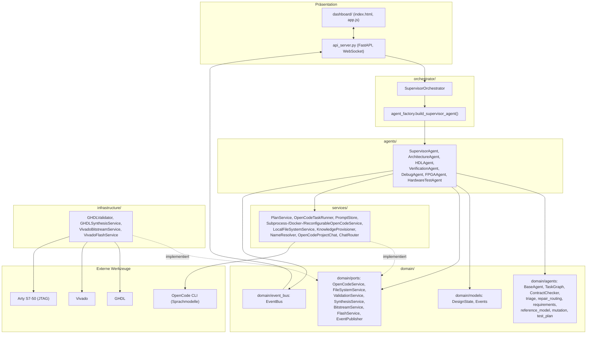
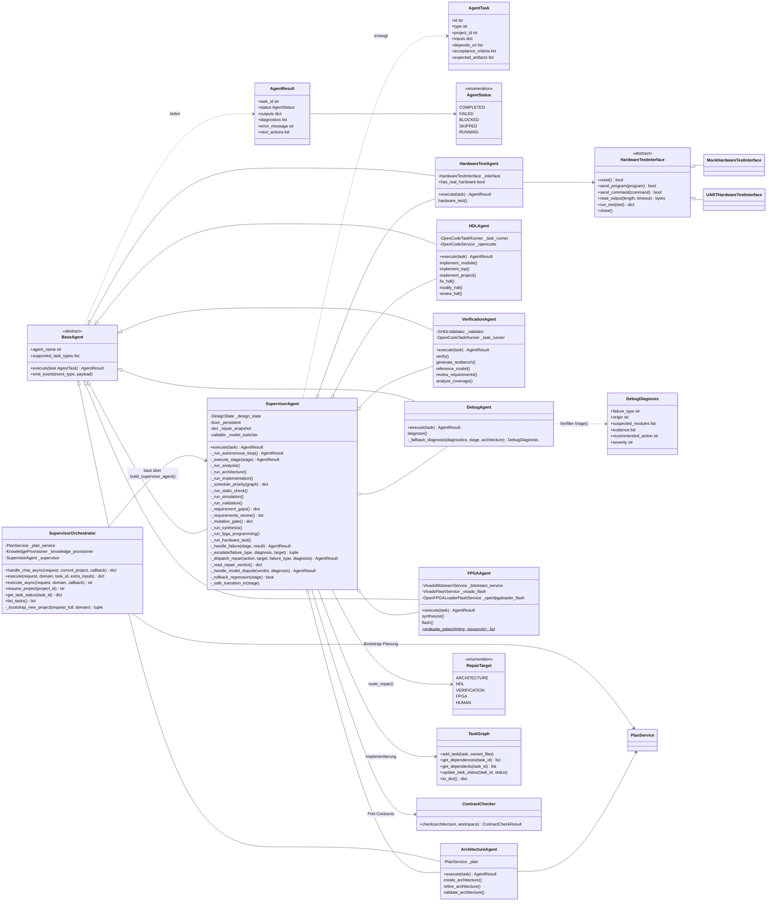
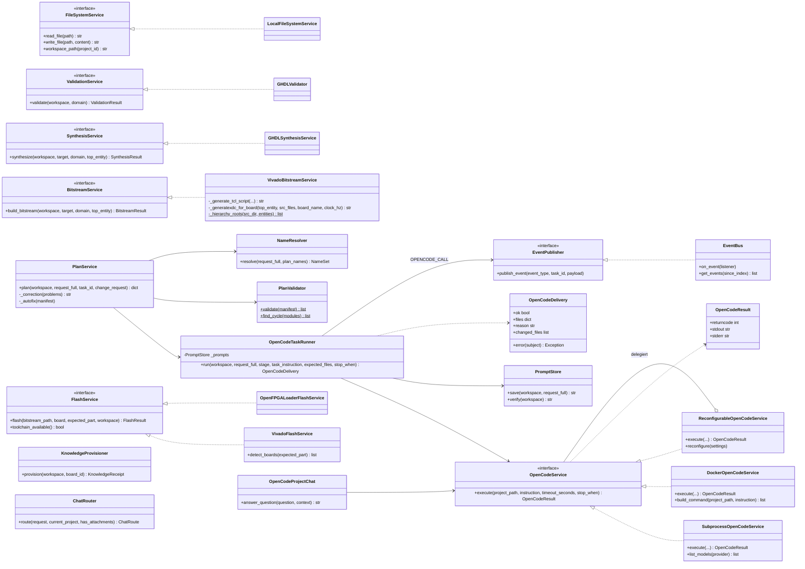
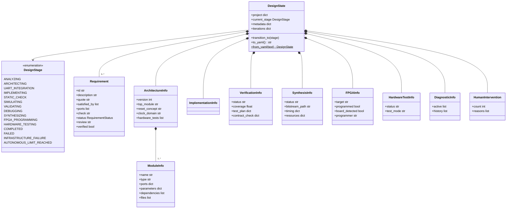

# UML-Modell des VHDL-Multiagentensystems

Stand: 2026-10-12 (Branch `mas-verbesserungen-2026-10-11`, Commit `63a4752`). Die Diagramme sind
aus dem Code unter `Schaltungsagent/src/` abgeleitet; Methoden sind auf die öffentliche
Schnittstelle und die für den Ablauf wichtigen internen Schritte beschränkt. Ablauf und
Fehlerbehandlung: [MAS-Ablauf.md](MAS-Ablauf.md).

Das Modell ist in vier Sichten aufgeteilt, weil ein einzelnes Diagramm mit über 60 Klassen
nicht lesbar wäre:

1. Paketübersicht (Schichten und Abhängigkeiten)
2. Agenten und Orchestrierung
3. Dienste, Ports und Adapter
4. Domänenmodell (Projektzustand)

## 1. Paketübersicht

## 2. Agenten und Orchestrierung

Fachliche Hilfsmodule des Supervisors (Funktionen, keine Klassen), alle unter `domain/agents/`:

| Modul | Aufgabe | Wichtige Funktionen |
|---|---|---|
| `triage.py` | Vorfilter aller Fehler: Kernzeilen, Herkunft, belegbare Module | `triage`, `key_lines`, `compact`, `classify_flash_output` |
| `repair_routing.py` | Fehlerklasse → zuständige Rolle | `route_repair` |
| `requirements.py` | Einzelanforderungen, `REQ`-Gate, Abschlussprüfung | `check_requirements`, `uncovered_simulation_requirements`, `parse_review`, `task_instruction_suffix` |
| `reference_model.py` | Differentieller Test gegen Python-Modell, Generic-Vertrag | `write_model_testbench`, `resolve_generics`, `mismatch_line` |
| `mutation.py` | Mutationsanalyse der Testbenches | `generate_mutants`, `run_mutation_analysis` |
| `test_plan.py` | Abdeckung je Modul und Anforderung | `build_test_plan` |
| `worker_instructions.py` | Gemeinsame Auftragsbausteine | `ghdl_selfcheck`, `source_compile_order`, `TESTBENCH_RULES` |

## 3. Dienste, Ports und Adapter

Hilfsfunktionen ohne eigene Klasse: `ensure_native_guard` und `isolate_workspace_repo`
(Sperre und eigenes Git-Repo je Workspace, `opencode_service.py`), `atomic_write_text`
(`opencode_task_runner.py`), `synthesis_digest` und Synthese-Cache (`agents/fpga.py`),
`yaml_io` (schnelles YAML für den Projektzustand).

## 4. Domänenmodell (Projektzustand `design_state.yaml`)

Wichtige Einträge in `DesignState.metadata`: `plan_manifest`, `request_full`, `reference_model`,
`model_testbench` (mit `generics`), `mutation`, `requirements_review`, `escalation` und
`escalation_log` (Versuche je Fehlerklasse und Modul mit Ergebnis), `repair_verdicts`,
`rollbacks`, `agent_notes`, `open_questions`, `task_graph` (nur Übersicht; der Graph steht in
`task_graph.json`).

Dateien im Projekt-Workspace (`projects/<name>/`): `PROMPT.md`, `design_state.yaml`,
`task_graph.json`, `plan/manifest.json`, `plan/requirements.md`, `src/*.vhd`, `tests/*_tb.vhd`
(davon `tests/<top>_model_tb.vhd` automatisch erzeugt), `model/reference_model.py`,
`constraints/*.xdc`, `reports/` (`repair_verdict.json`, `repair_notes.md`, `review.md`,
`requirements_review.json`), `build/` (GHDL, Synthese, Bitstream, Synthese-Cache), eigenes `.git`.
